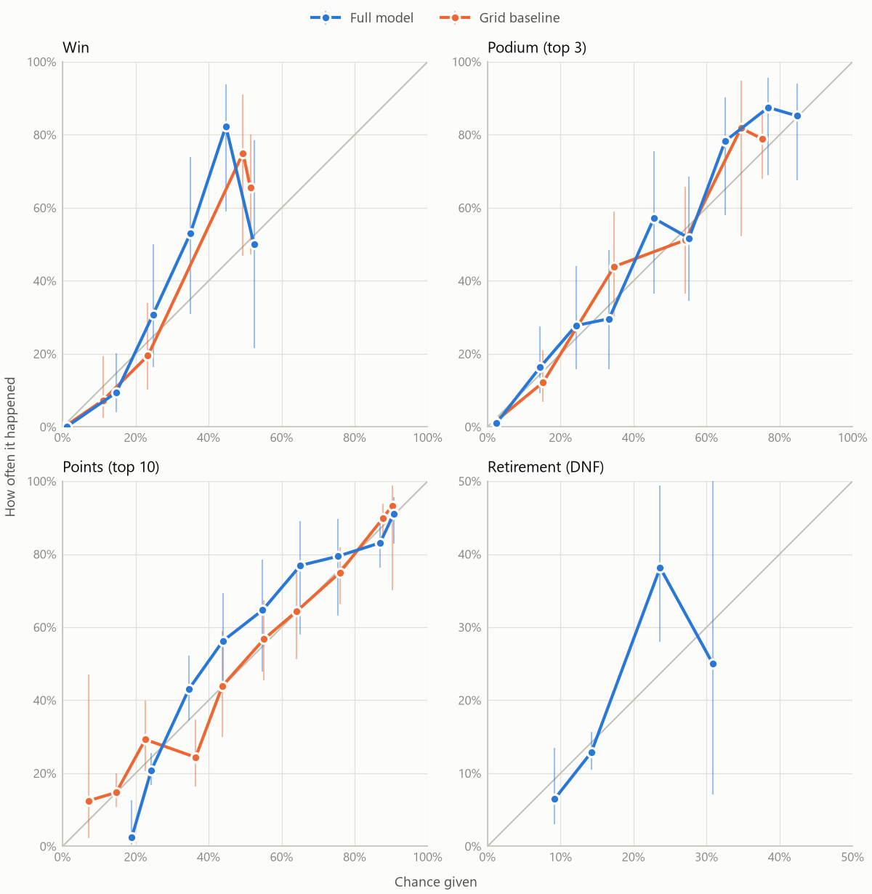
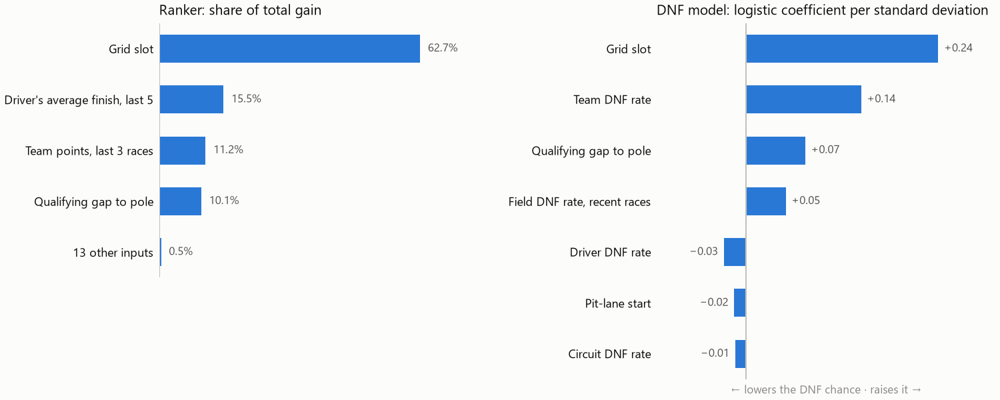

# f1-race-predictor

[](https://github.com/shrishrao/f1-race-predictor/actions/workflows/ci.yml)

Predicts a Formula 1 race right after qualifying: the full finishing order, plus each driver's
chance to **win**, finish on the **podium**, score **points** (top 10), and **retire** (DNF).

> **Status: in development.** The data pipeline, features, ranker, race simulation, DNF model,
> backtests (results below), the `predict` and `update` commands and the package API are done.
> A live Streamlit demo comes next.

## How it works

1. **Data**: race results, qualifying, sprints and schedules from the
   [Jolpica F1 API](https://github.com/jolpica/jolpica-f1) for 2018 to 2026; practice laps from
   [OpenF1](https://openf1.org) for 2023 to 2026 (earlier seasons have no practice features).
2. **Features**: leakage-safe, form-based features only (grid, qualifying gaps, recent form,
   practice pace). No team or driver identity features, because the 2026 regulation reset broke
   many of the old patterns.
3. **Model**: a LightGBM ranker scores every driver, and a Plackett-Luce simulation turns those
   scores into probabilities over 100,000 simulated races. A separate DNF model decides who
   retires in each simulated race: a logistic regression on the grid slot, qualifying gap,
   driver, team and circuit retirement rates and the field's recent retirement rate, chosen
   over LightGBM and a plain base rate on the 2024 season. A DNF is any start that doesn't
   reach the chequered flag (lapped cars count as finishers); cars that didn't start or were
   disqualified are left out of its training data.
4. **Evaluation**: a race-by-race backtest (each race is predicted using only earlier races)
   against a simple baseline: "everyone finishes where they started".

## Results

<!-- results:start -->
<!-- Generated by `python -m f1predict report` from the saved backtests. Edit the report code, not this block. -->

Every race was predicted by models trained only on the races before it. Validation season: 2024 (the ranker's settings, the simulation temperature and the DNF model were chosen there). Test seasons: 2025 (24 races) and 2026 (17 races). Values are season averages over races; brackets are 95% bootstrap confidence intervals, and differences are paired (both models scored on the same races). **Bold**: clearly better (the interval excludes 0); *italic*: clearly worse.

### Full model vs the grid baseline (2025 and 2026)

| Metric | Better | 2025 baseline | 2025 model | 2025 difference | 2026 baseline | 2026 model | 2026 difference |
| :--- | :--- | ---: | ---: | ---: | ---: | ---: | ---: |
| Winner accuracy | higher | 67% | 58% | −8% [−29%, +12%] | 71% | 76% | +6% [0%, +18%] |
| Podium hit rate | higher | 75% | 78% | +3% [−3%, +8%] | 63% | 65% | +2% [0%, +6%] |
| Position MAE | lower | 2.36 | 2.36 | −0.003 [−0.211, +0.205] | 2.02 | 1.93 | −0.086 [−0.351, +0.207] |
| Spearman | higher | 0.75 | 0.77 | +0.018 [−0.012, +0.052] | 0.81 | 0.84 | +0.022 [−0.020, +0.066] |
| Brier: win | lower | 0.027 | 0.029 | +0.002 [−0.004, +0.007] | 0.023 | 0.025 | +0.002 [−0.001, +0.005] |
| Brier: podium | lower | 0.058 | 0.056 | −0.002 [−0.009, +0.006] | 0.064 | 0.063 | −0.001 [−0.007, +0.004] |
| Brier: points | lower | 0.163 | 0.164 | 0.000 [−0.010, +0.011] | 0.168 | 0.173 | +0.005 [−0.010, +0.019] |
| Log loss: win | lower | 0.092 | 0.094 | +0.002 [−0.015, +0.018] | 0.086 | 0.087 | 0.000 [−0.024, +0.016] |
| Log loss: podium | lower | 0.203 | 0.195 | −0.008 [−0.030, +0.016] | 0.207 | 0.200 | −0.008 [−0.032, +0.012] |
| Log loss: points | lower | 0.500 | 0.499 | −0.001 [−0.026, +0.024] | 0.516 | 0.531 | +0.016 [−0.021, +0.050] |

### Ablations: what each group of features is worth

Below each value: the difference from the full model.

| Model | Spearman, 2025 | Spearman, 2026 | Winner accuracy, 2025 | Winner accuracy, 2026 |
| :--- | ---: | ---: | ---: | ---: |
| Full model | 0.77 | 0.84 | 58% | 76% |
| No practice | 0.77<br><sub>+0.001 [−0.004, +0.006]</sub> | 0.84<br><sub>+0.004 [0.000, +0.011]</sub> | 58%<br><sub>0% [0%, 0%]</sub> | 76%<br><sub>0% [0%, 0%]</sub> |
| Simple practice only | 0.77<br><sub>−0.002 [−0.005, +0.001]</sub> | 0.84<br><sub>0.000 [0.000, 0.000]</sub> | 58%<br><sub>0% [0%, 0%]</sub> | 76%<br><sub>0% [0%, 0%]</sub> |
| No grid or qualifying | 0.67<br><sub>*−0.099 [−0.145, −0.054]*</sub> | 0.79<br><sub>*−0.051 [−0.081, −0.020]*</sub> | 25%<br><sub>*−33% [−58%, −8%]*</sub> | 35%<br><sub>*−41% [−71%, −12%]*</sub> |
| Grid baseline | 0.75<br><sub>−0.018 [−0.052, +0.012]</sub> | 0.81<br><sub>−0.022 [−0.066, +0.020]</sub> | 67%<br><sub>+8% [−12%, +29%]</sub> | 71%<br><sub>−6% [−18%, 0%]</sub> |

### Retirements: the three DNF models (2025 and 2026)

| Metric | Model | 2025 | 2026 |
| :--- | :--- | ---: | ---: |
| Brier: DNF | Base rate | 0.099<br><sub>[0.076, 0.123]</sub> | 0.158<br><sub>[0.138, 0.180]</sub> |
|  | Logistic* | 0.097<br><sub>[0.075, 0.120]</sub> | 0.149<br><sub>[0.128, 0.172]</sub> |
|  | LightGBM | 0.096<br><sub>[0.074, 0.119]</sub> | 0.152<br><sub>[0.129, 0.177]</sub> |
| ROC AUC: DNF | Base rate | 0.473<br><sub>[0.357, 0.585]</sub> | 0.481<br><sub>[0.433, 0.537]</sub> |
|  | Logistic* | 0.575<br><sub>[0.480, 0.654]</sub> | 0.660<br><sub>[0.608, 0.718]</sub> |
|  | LightGBM | 0.583<br><sub>[0.485, 0.666]</sub> | 0.664<br><sub>[0.612, 0.719]</sub> |

### Calibration (2025 and 2026 pooled)

Cars are grouped by the chance they were given (0-10%, 10-20%, ...). On the diagonal, things happened exactly as often as predicted; above it, more often. Vertical bars are 95% intervals: a long bar means few cars in that group.

<picture>
  <source media="(prefers-color-scheme: dark)" srcset="docs/calibration-dark.png">
  
</picture>

### What the models lean on

Left: how much each input's splits improved the ranker. Right: how each input moves the log-odds of a retirement, per standard deviation of that input.

<picture>
  <source media="(prefers-color-scheme: dark)" srcset="docs/importance-dark.png">
  
</picture>

Every table, the 2024 validation season, and the numbers behind both plots: [docs/results.md](docs/results.md).
<!-- results:end -->

### What the numbers say (2026 through round 17)

- **Qualifying is most of the signal.** Without the grid and qualifying inputs, Spearman drops
  by 0.05-0.10 and the model picks the winner less than half as often. Practice laps add
  nothing measurable: dropping them moves Spearman by less than 0.005, and the ranker gives
  them under 1% of its gain.
- **The full model orders the field a little better than "finish where you start", but the
  test seasons can't confirm it.** Spearman is about 0.02 higher in both, with intervals that
  include 0. The clear gains are on 2024, the season its settings were chosen on.
- **Its chances are as good as the baseline's, not better.** No Brier score or log loss
  differs clearly in either test season. Simulating retirements is what got the points
  chances there: without it, the 2026 points log loss was 0.15 worse.
- **2025 vs 2026.** 2026, the first season of new regulations, has been easier to order from
  the grid (the baseline's Spearman too: 0.81 against 0.75) but harder for points: about 19%
  of starters retired, against 11% in 2025, and the DNF model's retirement level lags
  season-wide jumps like that.

## Quickstart (Windows PowerShell)

Requires Python 3.13 and Git.

```powershell
git clone https://github.com/shrishrao/f1-race-predictor.git
cd f1-race-predictor
py -3.13 -m venv .venv
.\.venv\Scripts\Activate.ps1
python -m pip install --upgrade pip
pip install -r requirements-dev.txt
pytest
python -m f1predict info
```

### Reproducing the results

The data isn't in the repo. `fetch` downloads it (Jolpica, then OpenF1 practice laps; the
first run takes a while, and everything is cached). Then build the features, backtest every
model, train, and rebuild the tables and plots above:

```powershell
python -m f1predict fetch
python -m f1predict build-features
python -m f1predict backtest
python -m f1predict backtest --model ranker
python -m f1predict backtest --model ranker --features no_practice
python -m f1predict backtest --model ranker --features simple_practice
python -m f1predict backtest --model ranker --features no_grid_quali
python -m f1predict backtest --model ranker --no-dnf
python -m f1predict train
python -m f1predict report
```

### Predicting a race

Once `fetch` has downloaded every season, each race weekend needs two commands after
qualifying:

```powershell
python -m f1predict update
python -m f1predict predict --season 2026 --round 18
```

`update` downloads the current season, rebuilds the features, retrains, and lists what's new.
`predict` prints the predicted order with each driver's chances and saves the same numbers as
JSON in `data/processed/predictions/`. A race that has already been run is predicted by models
trained only on the races before it, exactly as in the backtest, and shown next to its result.

Grid penalties and pit-lane starts announced after qualifying go in a small JSON file. Drivers
are named by their Jolpica id (as in the JSON output); everyone not named keeps their order:

```json
{"season": 2026, "round": 18, "grid": {"hamilton": 15}, "pitlane": ["stroll"]}
```

```powershell
python -m f1predict predict --season 2026 --round 18 --grid-override penalties.json
```

From Python, `predict` returns the same dict that the command saves:

```python
from f1predict import predict

result = predict(2026, 18)
for driver in result["drivers"][:3]:
    print(driver["name"], driver["p_win"])
```

## Project layout

```
f1predict/        the Python package: data, features, models, evaluate, CLI
app/              Streamlit demo app
tests/            pytest suite (runs offline; network access is blocked)
data/published/   small precomputed files the demo app reads (raw caches stay local)
models/           trained model files
docs/             plots used in this README
```

## Data sources and licenses

- Code: MIT (see [LICENSE](LICENSE)).
- Race, qualifying, sprint and schedule data come from the Jolpica F1 API under
  [CC BY-NC-SA 4.0](https://creativecommons.org/licenses/by-nc-sa/4.0/) (non-commercial use).
  Files in this repo derived from that data (test fixtures and published artifacts) carry the
  same license.
- Practice laps come from the OpenF1 API, also under
  [CC BY-NC-SA 4.0](https://creativecommons.org/licenses/by-nc-sa/4.0/) (non-commercial use).
  OpenF1 is used because Formula 1's own timing archive started requiring an F1 TV login in
  October 2026.
- This is an unofficial project and is not associated in any way with the Formula 1 companies.
  F1, FORMULA ONE, FORMULA 1, FIA FORMULA ONE WORLD CHAMPIONSHIP, GRAND PRIX and related marks
  are trademarks of Formula One Licensing B.V.
